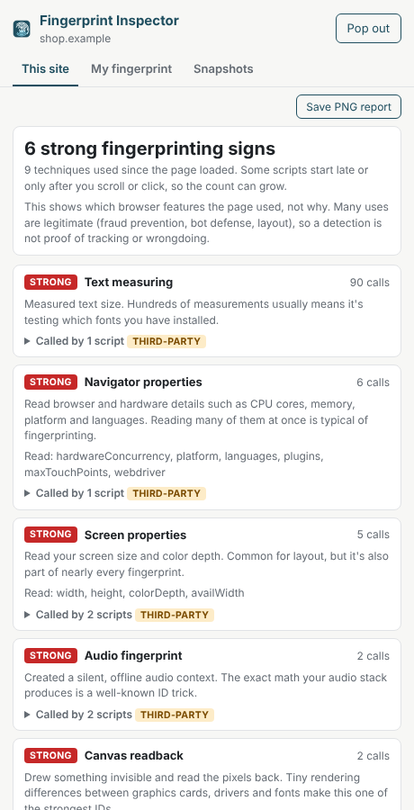
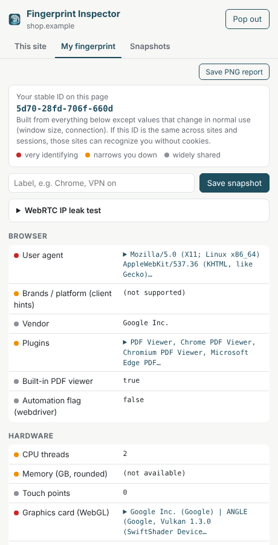

# Fingerprint Inspector

A free, open-source browser extension that shows the "fingerprint" your browser gives off to websites, and which fingerprinting techniques each site actually uses on you.

**Download and install:** https://davidfeuling.com/fingerprint-inspector/

 

## Features

- **This site:** which fingerprinting techniques the current page used (canvas and WebGL readback, audio fingerprinting, font probing, device lists and more), how often, and which scripts made the calls, with third-party scripts flagged.
- **My fingerprint:** everything your browser reveals, rated by how identifying each value is, rolled up into one stable ID. It also detects when your browser randomizes results to protect you.
- **Snapshots:** save your fingerprint in different situations (other browsers, private windows, VPN on or off) and compare exactly what changed.
- **PNG reports:** save a full-length image report of any tab to your Downloads folder.
- **Designed to keep data local:** it isn't built to collect or send your data. The only server it's designed to contact is Google's STUN server, during an optional WebRTC leak test you start yourself.

Works in Chrome, Edge, Brave, Opera, Vivaldi, and Firefox 128 or newer.

## Important

**This is a vibecoded hobby project** (built with AI-assisted coding) and has **not been independently security-audited**. It may contain bugs, including unforeseen data leaks or privacy problems. **Use it entirely at your own risk; the author accepts no liability.**

Results are **estimates, not proof**, and can be incomplete or wrong. A detection shows which browser features a page used, **not why**; many uses are legitimate (fraud prevention, bot defense, layout). Use it only on browsers and devices you own or are authorized to test. The extension is provided **as-is, with no warranty**. Read the full [Disclaimer and Terms of Use](DISCLAIMER.md) and [Privacy Policy](PRIVACY.md) before use; the extension asks you to accept them on first run.

## Install from source

1. Download this repository (or the zip from the [download page](https://davidfeuling.com/fingerprint-inspector/)) and unzip it.
2. **Chrome / Edge / Brave:** open `chrome://extensions`, turn on **Developer mode**, click **Load unpacked**, and choose the `extension` folder (or the `fingerprint-inspector` folder from the zip).
3. **Firefox 128+:** open `about:debugging#/runtime/this-firefox`, click **Load Temporary Add-on**, and choose `manifest.json`.

Full usage notes are in [extension/README.md](extension/README.md).

## Repository layout

| Path | What it is |
|---|---|
| `extension/` | The extension source (Manifest V3, plain JavaScript, no dependencies) |
| `downloads/` | Packaged zip offered on the download page |
| `index.html`, `images/` | The download page served at davidfeuling.com/fingerprint-inspector/ |
| `DISCLAIMER.md`, `PRIVACY.md`, `LICENSE` | Terms of use, privacy policy and MIT License |

## License

[MIT](LICENSE). Copyright (c) 2026 David Feuling.

Not affiliated with or endorsed by Google, Microsoft, Mozilla, Brave, Opera, Vivaldi or any website the extension inspects. Product names are trademarks of their respective owners.

Contact: dhf91@proton.me
